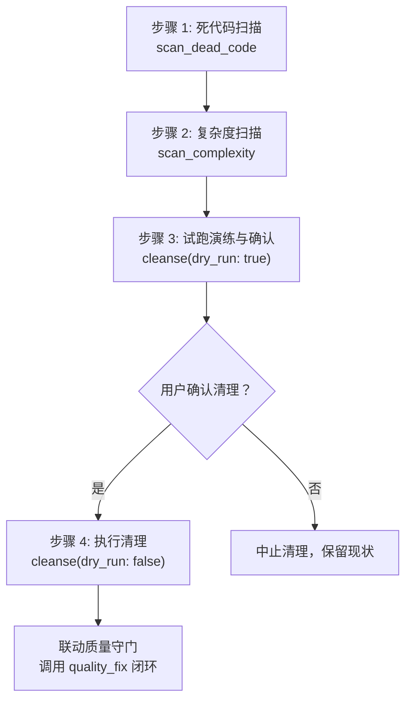

# 功能模块完成后的深度清理规范 (Deep Clean SOP)

本技能指导在任一功能模块开发完毕、提交代码或进入收尾阶段时，如何安全、高效、有条不紊地执行深度代码卫生清理与复杂度重构。

---

## 1. 触发时机与意图匹配

### 语义意图触发（“AI 自己判断时机”）
- 用户提及：“功能模块完成了”、“代码写完了，做下收尾清理”、“清理一下死代码”、“深度清理一下项目”、“把无用变量和导入删掉”。
- 阶段性收尾：当一个包含多个文件改动的复杂功能特性刚开发并验证通过，准备向用户交付或准备打 Git commit 时。

### 显式指令触发（“用户明确要它做”）
- 用户在聊天框输入 `/deep-clean`。

---

## 2. 核心清理目标与八项戒律 (Clenzer Rules)

| 规则项 | 约束阈值 | 处置策略 |
| :--- | :--- | :--- |
| **无用导入 (Unused Imports)** | 0 容忍 | 全部安全清理 |
| **未引用局部变量 (Unused Local Variables)** | 0 容忍 | 无副作用时安全清理；若有意保留需加 `_` 前缀（如 `_temp`） |
| **无用私有成员 (Unused Private Members)** | 0 容忍 | 从类/模块中移除 |
| **未导出死声明 (Unused Local Declarations)** | 0 容忍 | 从文件作用域中移除 |
| **单函数长度 (Function Length)** | ≤ 60 行 | 超过 60 行拆分提炼 helper 子函数 |
| **嵌套层级 (Nesting Depth)** | ≤ 4 层 | 超过 4 层使用卫语句（Guard Clauses）提早 return 拍平 |
| **单文件行数 (File Size)** | ≤ 600 行 | 巨型组件拆分为独立子模块 |
| **重复代码块 (Duplicate Blocks)** | < 6 行 | 6 行及以上重复逻辑抽为通用 hook 或 lib 工具函数 |

---

## 3. 标准执行四步法



### 步骤 1：死代码全面扫描
调用 MCP 工具 `clenzer.scan_dead_code`：
```json
{
  "project_root": "d:/project/academic_forum"
}
```
定位所有未引用的 imports、孤立的局部变量、未使用的私有成员与函数。

### 步骤 2：复杂度与代码异味排查
调用 MCP 工具 `clenzer.scan_complexity`：
```json
{
  "project_root": "d:/project/academic_forum"
}
```
标定长函数 (>60行)、深嵌套 (>4层) 与超大文件 (>600行)。

### 步骤 3：试跑演练与安全防护 (Dry Run)
在执行任何真实物理写操作前，**必须先执行试跑模式**：
```json
{
  "project_root": "d:/project/academic_forum",
  "dry_run": true
}
```
向用户展示拟删除或清理的文件与行号列表。

> [!CAUTION]
> **严禁未经试跑盲目直接删除代码**。对于导出的公共接口、可能被动态加载的组件或带有复杂解构的变量，必须人工复核确认其确实无外部引用。

### 步骤 4：确认清理与联动质量守门
- 用户确认后，调用 `cleanse(dry_run: false)` 执行安全清除；
- **核心联动**：清理完毕后，**必须立即调用 `quality_fix`**，运行 ESLint + Prettier 自动化补齐与语法校验，确保整个清理过程 0 语法报错、0 格式错乱。

---

## 4. 标准输出汇报模板

清理完成后，按以下格式向用户报告：

```markdown
### 🧹 深度清理与代码卫生收尾报告

#### 1. 死代码清理清单
- ✅ 移除无用导入：`X` 处（如 `import { ... } from '@/components/ui/...'`）
- ✅ 清除未读取变量：`Y` 个
- ✅ 清理孤立本地函数：`Z` 个

#### 2. 复杂度超标项待优化建议（如有）
| 文件路径 | 超标类型 | 当前数值 | 建议优化动作 |
| :--- | :--- | :--- | :--- |
| `src/components/...` | 函数过长 | 82 行 (>60) | 建议将渲染分支拆分为独立子组件 |
| `src/hooks/...` | 嵌套过深 | 5 层 (>4) | 建议采用卫语句提前返回 |

#### 3. 质量门禁验证
- 🛡️ 已自动运行 `quality_fix`：所有 ESLint 规则与 Prettier 格式化已 100% 通过。
```
